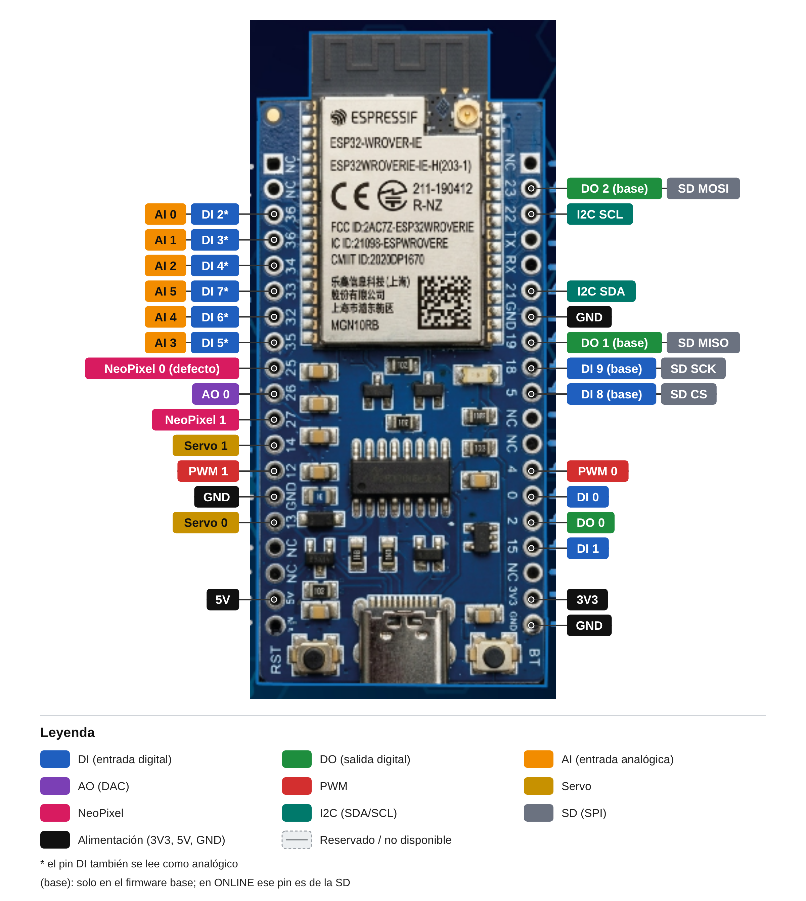
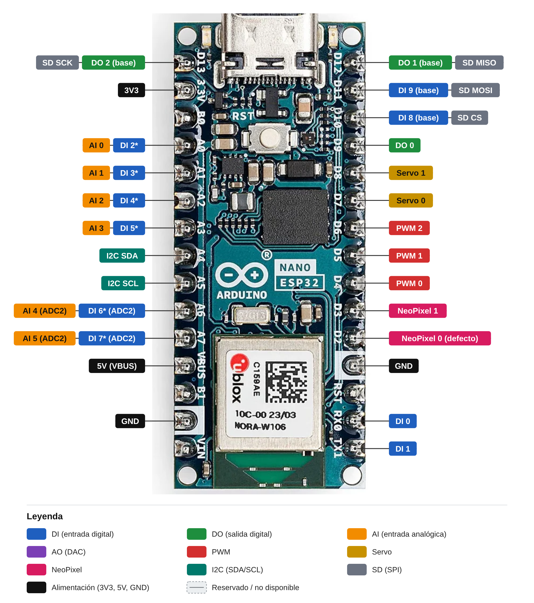
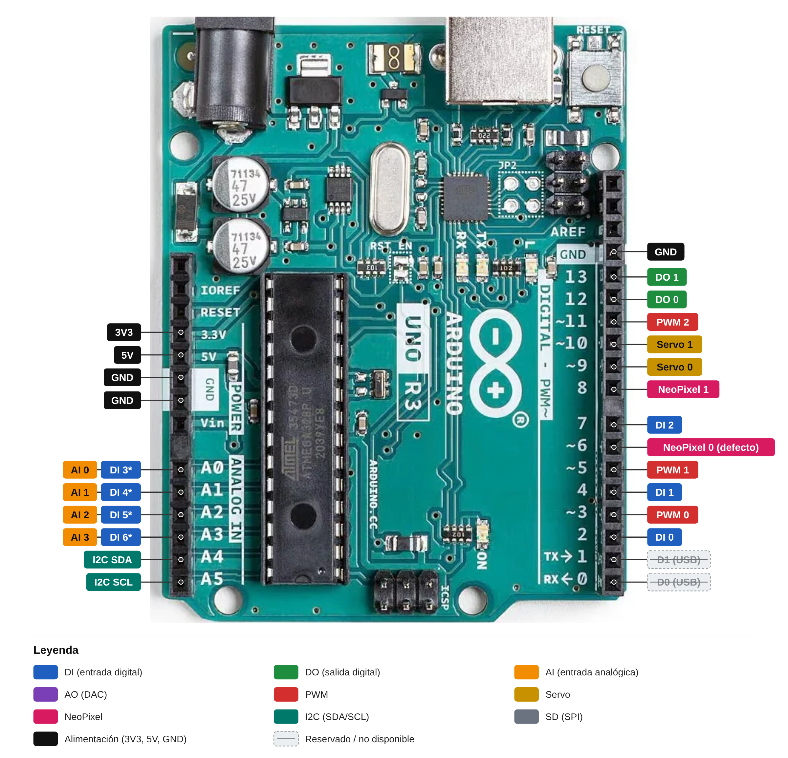
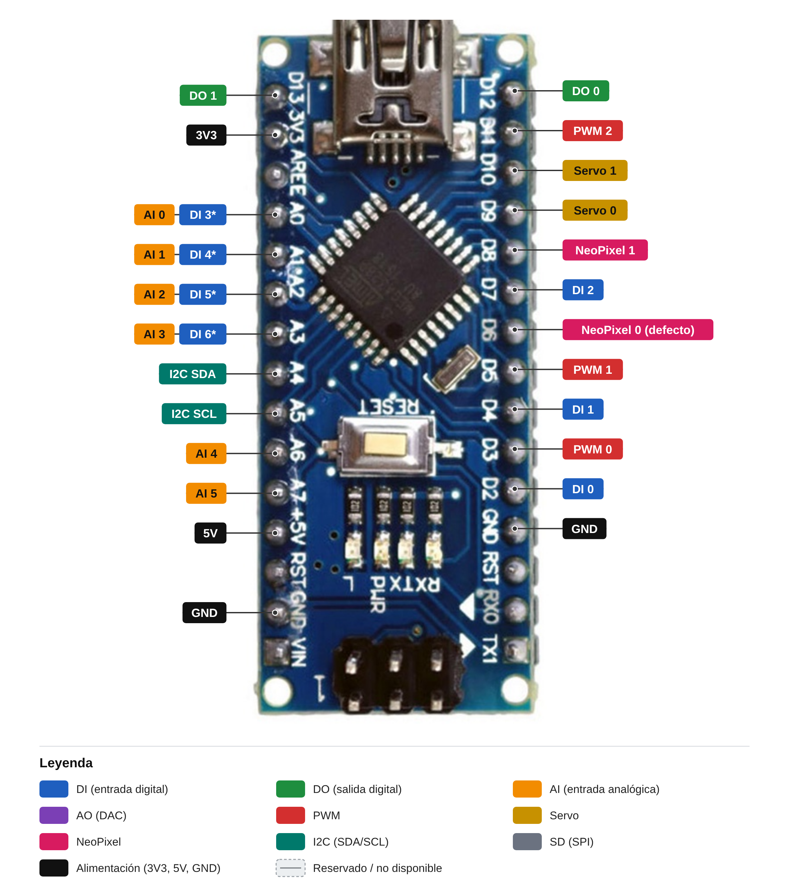
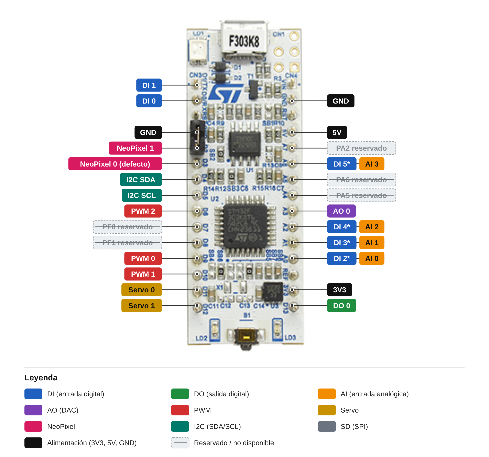

# Pinout 

LabVIEW manda el **número de canal**. 

**Cada canal tiene un rol fijo en cada microcontrolador**
(estilo PLC). 

Un canal fuera de rango responde `'X','X'` (en AI responde `-2`).

## Comandos
De base tenemos los siguientes comandos y funcionamiento:

| Tipo | Comando | Qué hace | Respuesta |
|---|---|---|---|
| DI | `0x02 [ch, 0]` | Entrada digital | `'A','0'/'1'` |
| DO | `0x01 [ch, v]` | Salida digital | `'A','A'` |
| AI | `0x05 [ch]` | Entrada analógica (resolución según microcontrolador) | `-1` = no disponible ahora (ADC2 con WiFi), `-2` = canal inválido |
| AO | `0x06 [ch, v]` | DAC real, 0..255 | `'A','A'` |
| GEN | `0xD0 [ch, forma, f3..f0, amp, off, duty]` / `0xD1 [ch]` / `0xD2 [ch]` | Generador de funciones sobre el DAC (solo ESP32 Wrover), ver la wiki | `'A','A'` (`0xD2` devuelve una línea de estado) |
| PWM | `0x07 [ch, d]` | 1 kHz, duty 0..255 | `'A','A'` |
| SERVO | `0x08 [ch, ang]` | 50 Hz, 0..180° (pulso 500–2400 µs) | `'A','A'` |
| NEO | `0x0A [opción]` | Elige el pin de la tira NeoPixel (16 píxeles). `0x03`/`0x04` no cambian | `'A','A'` |

`0xEF` (comando de identidad) devuelve
`LV,<variante>,<versión>,<mac>,<placa>,<nDI>,<nDO>,<nAI>,<nAO>,<nPWM>,<nSERVO>,<nNEO>`.

AI devuelve las cuentas en la resolución nativa de la placa, sin escalar:

| Placa | Resolución | Rango |
|---|---|---|
| ESP32 Wrover | 12 bits | 0 a 4095 |
| Arduino Nano ESP32 | 12 bits | 0 a 4095 |
| Nucleo F303K8 | 12 bits | 0 a 4095 |
| Arduino Uno | 10 bits | 0 a 1023 |
| Arduino Nano | 10 bits | 0 a 1023 |

Los canales **DI que comparten pin con AI** (marcados con *) se pueden leer como digital o analógico, el modo
se cambia solo en cada lectura. 

Los pines que dependen de la variante (Offline / Online) van al final de
DI y DO, así que los demás números de canal **no cambian** entre variantes.

## ESP32 Wrover - Offline

  

| Canal | DI | DO | AI | AO | PWM | SERVO | NEO |
|------:|----|----|----|----|-----|-------|-----|
| 0 | GPIO0 | GPIO2 | GPIO36 | GPIO26 (DAC1) | GPIO4 | GPIO13 | **GPIO25** (defecto) |
| 1 | GPIO15 | GPIO19 | GPIO39 | | GPIO12 | GPIO14 | GPIO27 |
| 2 | GPIO36 * | GPIO23 | GPIO34 | | | | |
| 3 | GPIO39 * | | GPIO35 | | | | |
| 4 | GPIO34 * | | GPIO32 | | | | |
| 5 | GPIO35 * | | GPIO33 | | | | |
| 6 | GPIO32 * | | | | | | |
| 7 | GPIO33 * | | | | | | |
| 8 | GPIO5 | | | | | | |
| 9 | GPIO18 | | | | | | |

### Notas
- **I2C del LCD:** SDA = GPIO21, SCL = GPIO22.
- LEDC: PWM usa canales 0–3, servo 4–7; los timers del LEDC se reparten por pares de canal, así que nunca chocan.
- GPIO12 (PWM canal 1) es pin de arranque (MTDI) la carga conectada debe estar desconectada al encender la ESP32.

## ESP32 Wrover - Online

Igual que Offline, pero GPIO5, 18, 19 y 23 pasan a ser la SD. DI termina en el canal 7 y DO en el canal 0.

- **SD (VSPI):** SCK = 18, MISO = 19, MOSI = 23, CS = 5.
- **I2C del LCD:** SDA = GPIO21, SCL = GPIO22.
- Todos los AI son ADC1, funcionan con el WiFi encendido.

## Arduino Nano ESP32 (ESP32-S3) - Offline

  

| Canal | DI | DO | AI | AO | PWM | SERVO | NEO |
|------:|----|----|----|----|-----|-------|-----|
| 0 | D0 | D9 | A0 | - | D4 | D7 | **D2** (defecto) |
| 1 | D1 | D12 | A1 | | D5 | D8 | D3 |
| 2 | A0 * | D13 | A2 | | D6 | | |
| 3 | A1 * | | A3 | | | | |
| 4 | A2 * | | A6 | | | | |
| 5 | A3 * | | A7 | | | | |
| 6 | A6 * | | | | | | |
| 7 | A7 * | | | | | | |
| 8 | D10 | | | | | | |
| 9 | D11 | | | | | | |

- **I2C del LCD:** A4 (SDA), A5 (SCL).
- **Sin DAC** (es S3): `AO` responde `'X','X'`, aun asi se puede utilizar un DAC con un circuito RC

## Arduino Nano ESP32 (ESP32-S3) - Online

Igual que Offline, pero D10, D11, D12 y D13 pasan a ser la SD. DI termina en el canal 7 y DO en el canal 0.

- **SD:** SCK = D13, MISO = D12, MOSI = D11, CS = D10.
- A6 y A7 son ADC2, devuelven `-1` mientras el WiFi esté conectado.

## Arduino Uno

  

| Canal | DI | DO | AI | AO | PWM | SERVO | NEO |
|------:|----|----|----|----|-----|-------|-----|
| 0 | D2 | D12 | A0 | - | D3 | D9 | **D6** (defecto) |
| 1 | D4 | D13 | A1 | | D5 | D10 | D8 |
| 2 | D7 | | A2 | | D11 | | |
| 3 | A0 * | | A3 | | | | |
| 4 | A1 * | | | | | | |
| 5 | A2 * | | | | | | |
| 6 | A3 * | | | | | | |

- **I2C del LCD:** A4 (SDA), A5 (SCL).
- `Servo.h` usa el Timer1: por eso D9/D10 son solo servo y no se ofrecen como PWM.

## Arduino Nano

  

| Canal | DI | DO | AI | AO | PWM | SERVO | NEO |
|------:|----|----|----|----|-----|-------|-----|
| 0 | D2 | D12 | A0 | - | D3 | D9 | **D6** (defecto) |
| 1 | D4 | D13 | A1 | | D5 | D10 | D8 |
| 2 | D7 | | A2 | | D11 | | |
| 3 | A0 * | | A3 | | | | |
| 4 | A1 * | | A6 | | | | |
| 5 | A2 * | | A7 | | | | |
| 6 | A3 * | | | | | | |

- **I2C del LCD:** A4 (SDA), A5 (SCL). D0/D1 son el USB.
- A6 y A7 son solo analógicos: no están en la lista DI.
- `Servo.h` usa el Timer1: por eso D9/D10 son solo servo y no se ofrecen como PWM.

## Nucleo F303K8

  

| Canal | DI | DO | AI | AO | PWM | SERVO | NEO |
|------:|----|----|----|----|-----|-------|-----|
| 0 | PA10 (D0) | PB3 (D13, LED) | PA0 (A0) | PA4 (A3, DAC1) | PA8 (D9) | PB5 (D11) | **PB0 (D3)** (defecto) |
| 1 | PA9 (D1) | | PA1 (A1) | | PA11 (D10) | PB4 (D12) | PA12 (D2) |
| 2 | PA0 * | | PA3 (A2) | | PB1 (D6) | | |
| 3 | PA1 * | | PA7 (A6) | | | | |
| 4 | PA3 * | | | | | | |
| 5 | PA7 * | | | | | | |

- **I2C del LCD:** PB7 (SDA, D4), PB6 (SCL, D5).
- **Reservados:**
  - PA2/PA15 (VCP del ST-Link = el puerto del protocolo)
  - PA13/PA14 (SWD)
  - PA5/PA6 (unidos a PB7/PB6 por los puentes SB18/SB16)
  - PF0/PF1 (reloj del ST-Link, D7/D8)
